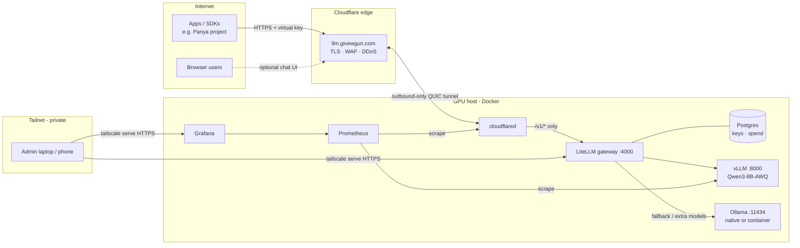
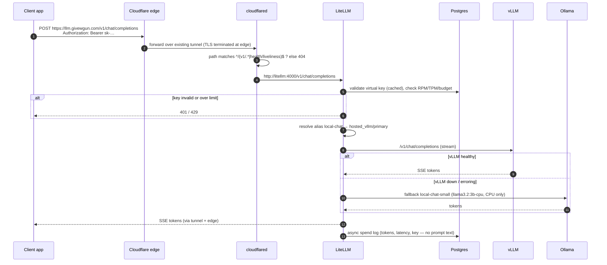
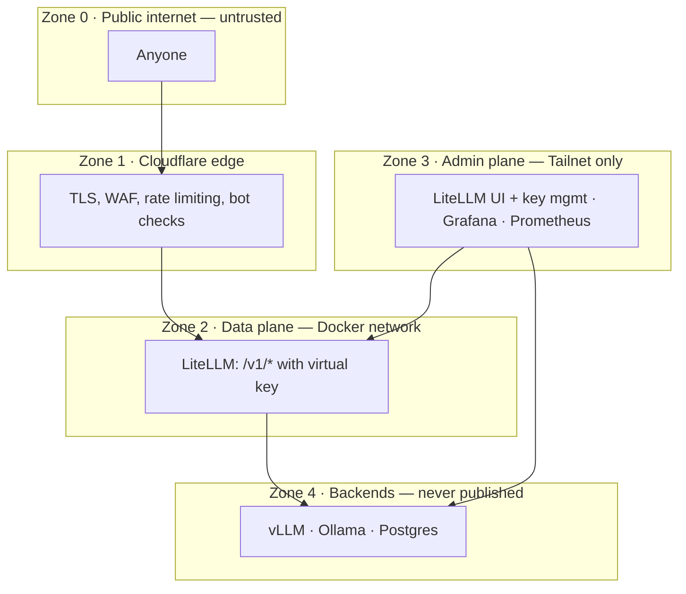
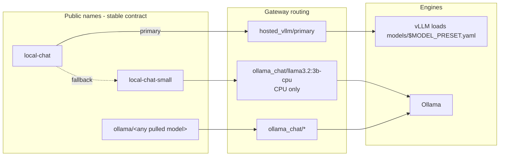
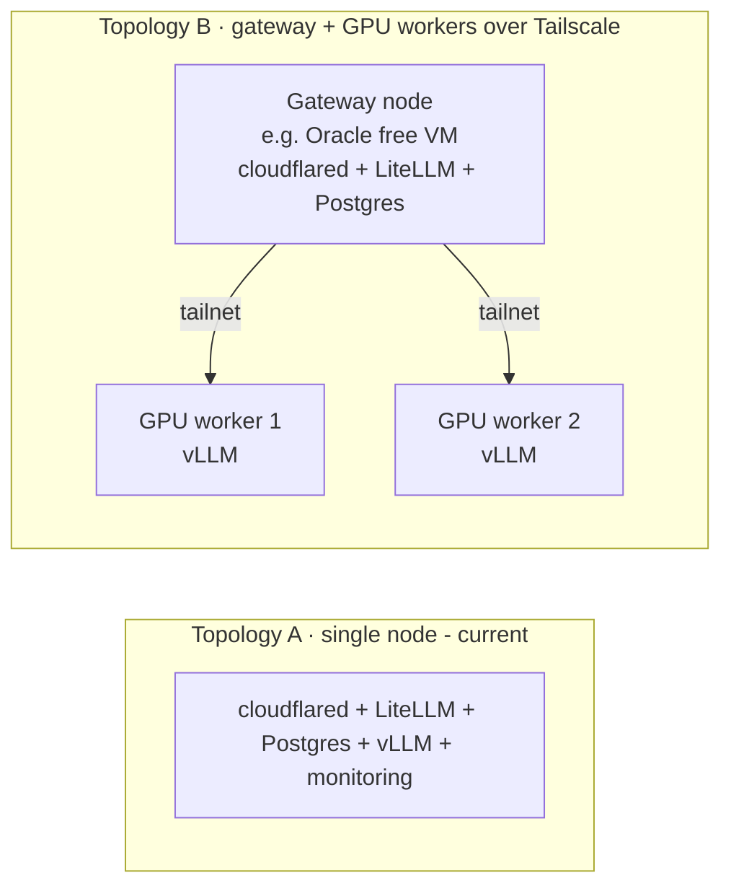

# Architecture

> New to LLM serving? Read [how-it-works.md](how-it-works.md) first.

A self-hosted, OpenAI-compatible LLM API that runs on a consumer GPU box and is
reachable from anywhere on the internet — without opening a single inbound port.

## Goals

| Goal | How |
|------|-----|
| **OpenAI-compatible** — any SDK/tool works unchanged | vLLM + LiteLLM both speak the OpenAI API |
| **Production throughput** on one GPU | vLLM: PagedAttention, continuous batching, prefix caching, CUDA graphs |
| **Multi-tenant** — hand out keys, cap usage, revoke | LiteLLM virtual keys (Postgres-backed) with RPM/TPM/parallel/budget limits |
| **Model swaps without client changes** | Stable public aliases (`local-chat`) decoupled from the loaded model |
| **Zero inbound exposure** | Cloudflare Tunnel (outbound-only); admin plane only on Tailscale |
| **Resilient** | Healthchecks, restart policies, automatic fallback vLLM → Ollama |
| **Observable** | Prometheus + Grafana: tokens/s, TTFT, queue depth, KV cache, tunnel health |
| **Reproducible** | Everything is `compose.yaml` + pinned image tags + `.env`; one CLI (`llmctl`) |

## System context

## Components

| Component | Role | Exposed on |
|-----------|------|------------|
| **vLLM** | GPU inference engine. Loads one model preset (`models/*.yaml`), serves it as `primary`. | Docker network; host loopback `:8000` for debugging |
| **Ollama** | Secondary engine: hot-swappable GGUF models, CPU/GPU offload, fallback target. Native on Windows/macOS, `ollama` profile on Linux. | Host `:11434` |
| **LiteLLM** | API gateway: auth (virtual keys), rate limits, budgets, routing, fallbacks, retries, spend logging, admin UI. | Docker network; host loopback `:4000` |
| **Postgres** | LiteLLM state: keys, users, teams, spend logs. | Docker network only |
| **cloudflared** | Outbound tunnel to Cloudflare. Path-allowlists the public surface. | Nothing — outbound only |
| **Prometheus / Grafana** | Metrics + the `LLM Server` dashboard. | Host loopback `:9090` / `:3000` |
| **API docs** *(optional, `docs` profile)* | Swagger UI over a hand-curated OpenAPI spec (`config/api-docs/openapi.yaml`) covering only the public routes. Same origin as the API, so *Try it out* works. | `<api-host>/docs` via the tunnel; no host port |
| **Open WebUI** *(optional)* | ChatGPT-style UI for non-developers, uses a LiteLLM virtual key. | Host loopback `:8080`; `chat.<domain>` when enabled |

## Request flow

## Trust zones

Rules enforced:

1. **No inbound ports.** Router/NAT untouched. All public traffic arrives over the tunnel.
2. **Path allowlist at the edge connector.** `cloudflared` forwards only `/v1/*`, `/health/liveliness` and (with the `docs` profile) the curated Swagger UI at `/docs`; `/ui`, `/key/*`, `/spend/*` etc. return 404 from the public hostname.
3. **Everything else binds to `127.0.0.1`.** Admin UIs are reached through `tailscale serve` (tailnet-only HTTPS).
4. **Defence in depth on backends.** vLLM requires its own API key even on the internal network.
5. **Least-privilege keys.** Clients get LiteLLM virtual keys with model allowlists and limits; the master key never leaves the host.

See [security.md](security.md) for the threat model.

## Model abstraction

Swapping the model is `./llmctl model use <preset>`: vLLM restarts with a new
preset while LiteLLM keeps answering `local-chat` from the Ollama fallback. Clients
never change a line.

## Deployment topologies

The same repo covers single-box and multi-box setups by toggling `COMPOSE_PROFILES`
and two URLs. See [scaling.md](scaling.md).

## Why these choices

Short versions; full reasoning in [`docs/adr/`](adr/).

- **vLLM *and* LiteLLM, not either/or.** vLLM is the engine (fast batching on the GPU); LiteLLM is the gateway (keys, limits, routing, fallbacks). Different layers — industry setups run both. Ollama stays as the convenient secondary engine. → [ADR-0001](adr/0001-inference-engine.md), [ADR-0002](adr/0002-api-gateway.md)
- **Cloudflare Tunnel, not port-forwarding.** No exposed home IP, free TLS/WAF/DDoS, works behind CGNAT. → [ADR-0003](adr/0003-public-ingress.md)
- **Tailscale for admin, not public auth.** The admin surface simply isn't on the internet. → [ADR-0004](adr/0004-admin-plane.md)
- **Docker Compose, not Kubernetes.** One box; Compose gives healthchecks, restarts, profiles with zero platform overhead. Move to k8s only at multiple GPU nodes needing scheduling. → [ADR-0005](adr/0005-orchestration.md)
