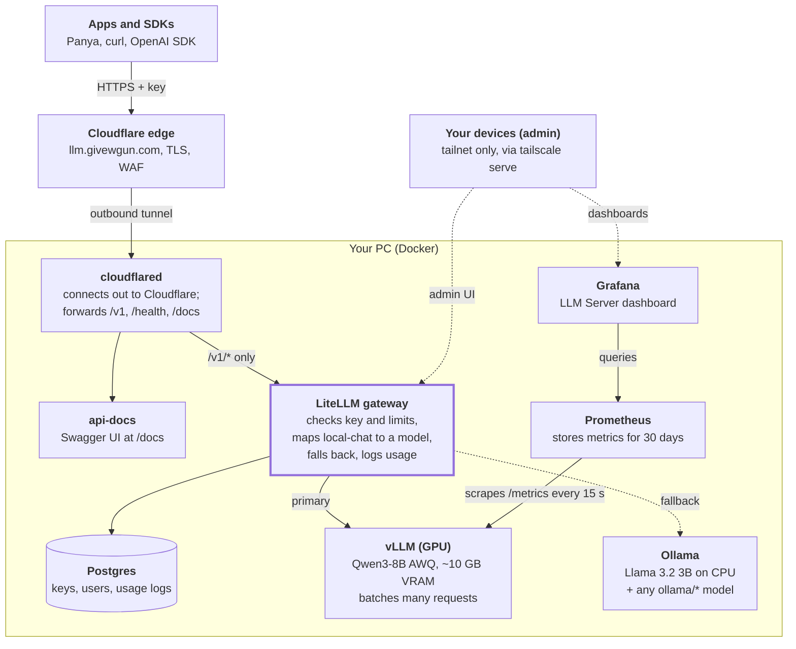

# How the Local LLM Server Works

*For engineers who know web backends but have never hosted an LLM. Last updated 2026-10-29.*

## TL;DR

This is a home GPU running an LLM behind an API that looks exactly like OpenAI's, reachable at `https://llm.givewgun.com/v1` from anywhere, with no open router ports. If you have built a web service, you already know the shape: a worker that does the heavy lifting (vLLM on the GPU), an API gateway in front of it (LiteLLM, which handles auth, rate limits and routing), a database for that gateway (Postgres), a reverse tunnel for ingress (Cloudflare Tunnel), a VPN for admin access (Tailscale), and metrics with dashboards (Prometheus and Grafana).



Read it top down: a request enters at Cloudflare, comes down the tunnel, passes LiteLLM, and is answered by vLLM on the GPU (or Ollama when vLLM is unavailable). You reach the admin side only from your own Tailscale devices (dotted lines).

The only genuinely new part is the worker. An LLM server is a GPU-bound process that loads several gigabytes of model weights into video memory once, then turns text into more text one token at a time. Most of what follows explains why that makes it behave differently from a normal web backend.

Everything runs as Docker containers from one `compose.yaml`, driven by one script, `llmctl`. The repo is [givewgun/local-llm-server](https://github.com/givewgun/local-llm-server).

## LLM serving in 10 concepts

These ten ideas explain almost every design choice in this setup.

| Concept | What it means | Why it matters here |
| --- | --- | --- |
| **Model weights** | The trained model: a big file of numbers (billions of parameters). Downloaded once from Hugging Face. | Qwen3-8B has 8 billion parameters. At full 16-bit precision that is about 16 GB, which would fill this whole GPU. |
| **VRAM** | Memory on the graphics card. The model must sit in VRAM to run fast. | 16 GB total on the RTX 5060 Ti. It is the scarcest resource and drives every sizing decision. |
| **Quantization** | Storing weights in fewer bits (4-bit instead of 16-bit). Small quality loss, about 4x less memory. | The model used is the AWQ 4-bit version: about 6 GB instead of 16 GB. |
| **Token** | The unit an LLM reads and writes, roughly 3/4 of a word. | Limits, speed and context are all measured in tokens, not characters or requests. |
| **Inference / generation** | Running the model: it predicts the next token, appends it, repeats. | Output is produced sequentially, which is why responses stream and why long answers take longer. |
| **Prefill vs decode** | Prefill reads the whole prompt in one fast pass. Decode then generates one token per step. | Time to first token (TTFT) is mostly prefill; tokens per second is decode speed. Both are on the Grafana dashboard. |
| **KV cache** | Per-request working memory the model keeps for every token it has seen, so it doesn't recompute them. | Lives in VRAM next to the weights. Here about 4 GB, enough for about 30,000 tokens across all requests in flight. When it fills up, requests wait. |
| **Context window** | Maximum tokens per request (prompt + answer). | Set to 16,384. Larger would need more KV cache per request, so fewer requests at once. |
| **Continuous batching** | Running many users' requests through the GPU together, adding and removing them on every step. | The main reason to use vLLM: 10 users at once are barely slower than 1. A naive server would queue them. |
| **OpenAI-compatible API** | The de-facto standard HTTP API (`POST /v1/chat/completions` with a `messages` list). | Any OpenAI SDK, LangChain, or tool works by changing only the base URL and key. |

The mental model: **the GPU is a fixed-size box**. Weights take a fixed slice, the KV cache takes what is left, and the KV cache decides how many conversations can run at once. Most operational problems are something else taking part of that box.

## The components

Nine containers, each with one job. The "web stack equivalent" column maps each to something you already know.

| Component | Web stack equivalent | What it does here | Reachable from |
| --- | --- | --- | --- |
| **vLLM** | App server (the worker) | Loads the model into VRAM and serves it over an OpenAI-style API. Does the batching and KV cache management. Serves under the internal name `primary`. | Docker network only (+ `127.0.0.1:8000` for debugging) |
| **Ollama** | A second, simpler worker | Runs a small model (Llama 3.2 3B) on the CPU as a fallback, plus any model you `ollama pull`. Already installed natively on Windows; there is a container version for Linux. | `127.0.0.1:11434` |
| **LiteLLM** | API gateway (like Kong / nginx + auth) | The front door. Checks the API key, applies rate limits, maps public model names to workers, retries and falls back, logs usage. Has an admin web UI. | Docker network + `127.0.0.1:4000` |
| **Postgres** | Database | Stores LiteLLM's API keys, users, teams and usage logs. The only data worth backing up. | Docker network only |
| **cloudflared** | Reverse tunnel / ingress | Opens an outbound connection to Cloudflare. Requests to `llm.givewgun.com` come back down that connection. Only forwards `/v1/*`, `/health/liveliness` and `/docs`. | Nothing; it only connects out |
| **Tailscale** | Private VPN | Not a container: installed on Windows. `tailscale serve` publishes the admin UI and Grafana to your own devices only. | Your tailnet devices |
| **Prometheus** | Metrics database | Pulls metrics every 15 s from vLLM and cloudflared, keeps 30 days. | `127.0.0.1:9090` |
| **Grafana** | Dashboards | Draws the "LLM Server" dashboard from Prometheus: tokens/s, latency, queue, KV cache, tunnel health. | `127.0.0.1:3000` + tailnet `:8443` |
| **api-docs** | Swagger / API reference | Swagger UI over a hand-written spec of the public routes, at `llm.givewgun.com/docs`. | Public, via the tunnel |

### Why both vLLM and LiteLLM

They sit at different layers, so this is not an either/or.

- **vLLM is the engine.** It is very good at running one model fast for many users. It knows nothing about who the users are; it accepts one shared key.
- **LiteLLM is the gateway.** It knows nothing about GPUs. It gives each consumer their own key with limits, gives models stable public names, and decides where each request goes.

This is the same split as "app server behind an API gateway" in a normal backend, and it is how most self-hosted LLM platforms are built.

### Why Ollama is still here

vLLM loads one model per process, and restarting it takes 1 to 5 minutes. Ollama loads and unloads models on demand, so it covers two gaps: a fallback while vLLM is down or switching models, and quick access to any other model without touching vLLM. Ollama's fallback model runs on the CPU on purpose, so it never takes VRAM that vLLM needs.

## Life of a request

A chat request from an app (say Panya) passes through four hops before it reaches the GPU. On a warm system it costs about 0.35 to 0.5 s end to end.

1. **The app calls the API.** `POST https://llm.givewgun.com/v1/chat/completions` with header `Authorization: Bearer sk-...` and `"model": "local-chat"`. It uses any OpenAI SDK, pointed at this base URL.
2. **Cloudflare's edge receives it.** DNS for `llm.givewgun.com` points at Cloudflare, not your house. Cloudflare terminates HTTPS, applies its DDoS and firewall protection, and finds the tunnel registered for this hostname.
3. **The request travels down the tunnel.** `cloudflared` on your PC keeps several long-lived outbound connections to Cloudflare. The request arrives over one of them. `cloudflared` checks the path against its allowlist: `/v1/...` passes, anything else (such as `/ui`) gets a 404 right there.
4. **LiteLLM authenticates and routes.** It looks up the key (cached, backed by Postgres), checks that key's limits (requests per minute, tokens per minute, requests in parallel, allowed models), and returns 401 or 429 if anything fails. It then maps `local-chat` to the vLLM worker.
5. **vLLM generates.** The request joins the running batch on the GPU. Prefill reads the prompt; decode streams tokens back as they are produced.
    - If vLLM is down or erroring, LiteLLM retries once, then falls back to `local-chat-small` on Ollama (CPU). The response header `x-litellm-attempted-fallbacks: 1` tells the client this happened.
6. **Tokens stream back.** vLLM to LiteLLM to cloudflared to Cloudflare to the app, as Server-Sent Events (`data: {...}` lines, ending in `data: [DONE]`).
7. **LiteLLM logs usage.** Asynchronously, it writes tokens used, latency and the key to Postgres. The prompt and answer text are not stored (`turn_off_message_logging`).

Two practical consequences:

- **Use streaming for long answers.** Cloudflare closes a proxied request that sends nothing for about 100 seconds (error 524). Streaming sends bytes continuously, so it never trips that limit.
- **The model name is a contract, not a model.** Clients say `local-chat`; what actually answers can change underneath (a model swap or the fallback) without clients changing anything.

## Networking and security

The router has no open ports, and the only thing the internet can reach is the `/v1` API (plus its docs). Everything else is either loopback-only or on Tailscale.

### Why a tunnel instead of port forwarding

The classic way to expose a home server is to forward port 443 on the router and run a reverse proxy with Let's Encrypt. That exposes your home IP, needs router access, fails behind carrier-grade NAT, and leaves you to absorb any attack.

A tunnel flips the direction. `cloudflared` dials **out** to Cloudflare and keeps the connection open; Cloudflare sends requests back down it. Nothing listens on your public IP, visitors only ever see Cloudflare's addresses, and TLS, firewall and DDoS protection happen at Cloudflare's edge.

### Two planes

|  | Data plane (public) | Admin plane (private) |
| --- | --- | --- |
| Who | Apps and users with an API key | You |
| How | `llm.givewgun.com` via Cloudflare Tunnel | `gunizuka.tail18c7f0.ts.net` via Tailscale, or `127.0.0.1` on the PC |
| What | `/v1/*`, `/health/liveliness`, `/docs` | LiteLLM admin UI and key management, Grafana, Prometheus, LiteLLM's full Swagger |
| Auth | Virtual API key per consumer | Tailscale device login, then UI password or master key |

Every container port is bound to `127.0.0.1`, so even other machines on your home Wi-Fi can't reach them. `tailscale serve` is a small proxy that forwards your tailnet hostname to those loopback ports.

### Keys

- **Master key** (`LITELLM_MASTER_KEY` in `.env`): the root credential. It can mint and revoke keys. It never leaves the PC.
- **Virtual keys**: one per consumer (for example `panya`), each with its own allowed models and limits. Revoke one without affecting anyone else: `bash llmctl key revoke panya`.
- **vLLM key** (`VLLM_API_KEY`): only LiteLLM uses it. vLLM checks it even on the internal network, as a second layer.
- **Tunnel credentials** (`config/cloudflared/<id>.json`): anyone with this file can run your tunnel. Treat it like a private key.

All of these live in git-ignored files (`.env`, `config/cloudflared/`, `.keys/`). The secrets in `.env` are generated fresh on each machine by `llmctl init`.

### Trade-off to know about

Cloudflare decrypts the traffic at its edge, so in principle Cloudflare can see prompts and answers. That is fine for a test or hobby API. For sensitive data, skip the tunnel and give clients Tailscale access instead.

## How models work here

The model is configuration, not code: switching it is one command, and clients never notice except in the quality of answers.

### Presets

Each file in `models/` is a preset: a few lines of vLLM settings for one model. For example `models/qwen3-8b-awq.yaml`:

```yaml
model: Qwen/Qwen3-8B-AWQ          # Hugging Face repo to download
max-model-len: 16384              # context window
max-num-seqs: 16                  # max requests decoding at once
enable-prefix-caching: true       # reuse work for repeated prompt starts
reasoning-parser: qwen3           # split "thinking" from the answer
enable-auto-tool-choice: true     # function calling
tool-call-parser: hermes
default-chat-template-kwargs: {"enable_thinking": false}
```

`.env` picks the active one (`MODEL_PRESET=qwen3-8b-awq`) and sets the one machine-specific knob, `VLLM_GPU_MEMORY_UTILIZATION=0.70`: the share of total VRAM vLLM may claim.

### Public names

| Clients send | What answers | Notes |
| --- | --- | --- |
| `local-chat` | vLLM, whatever preset is loaded | The name to use. Falls back to `local-chat-small` if vLLM fails. |
| `local-chat-small` | Llama 3.2 3B on CPU via Ollama | About 20 tokens/s; lower quality. Never uses VRAM. |
| `ollama/<name>` | Any model pulled into Ollama | Only if the key's allowed models include it. |

### Switching models

`bash llmctl model use qwen2.5-7b-instruct-awq` does four things:

1. Sets `MODEL_PRESET` in `.env`.
2. Unloads any Ollama models sitting in VRAM.
3. Recreates the vLLM container. First use of a model downloads it (about 6 GB), then loads and compiles it: 1 to 5 minutes.
4. Waits until vLLM reports healthy. Meanwhile `local-chat` is answered by the CPU fallback.

### Sharing the GPU

vLLM measures free VRAM **once, at startup**, and claims its share: weights plus a pre-allocated KV cache. Anything else holding VRAM at that moment shrinks the cache, or stops vLLM from starting at all. This actually happened during setup: Ollama still had two models loaded, and vLLM computed a KV budget of minus 4.5 GB and refused to start.

That is why `llmctl` clears Ollama's VRAM before vLLM starts, and why the fallback model runs on CPU. Day to day, budget the 16 GB roughly like this:

| Slice | Size |
| --- | --- |
| Windows desktop and apps | about 1 GB |
| vLLM: Qwen3-8B AWQ weights | about 5.5 GB |
| vLLM: activations, CUDA graphs | about 1 GB |
| vLLM: KV cache (30,064 tokens) | about 4.1 GB |
| Free for games or Ollama GPU models (measured: 11.4 of 16.3 GB in use) | about 4.5 GB |

If you game on this PC, a heavy game plus vLLM may not fit. Stop vLLM first (`docker compose stop vllm`) and the fallback keeps the API answering.

## Operating it

One script does everything: on Windows run it from Git Bash in the repo folder as `bash llmctl <command>`.

| Task | Command |
| --- | --- |
| Start or apply `.env` changes | `bash llmctl up` |
| Stop everything | `bash llmctl down` |
| What's running | `bash llmctl ps` |
| Follow logs | `bash llmctl logs vllm` (or `litellm`, `cloudflared`, ...) |
| Health check, local | `bash llmctl test` |
| Health check, through Cloudflare | `bash llmctl test public sk-...` |
| List / switch models | `bash llmctl model list` · `bash llmctl model use <preset>` |
| Issue a key | `bash llmctl key create <name> --models local-chat --rpm 60` |
| List / revoke keys | `bash llmctl key list` · `bash llmctl key revoke <name>` |
| Back up keys and usage | `bash llmctl backup` |

### Where to look when something breaks

Start from the HTTP status the client sees; it tells you which hop failed.

| Client sees | Failed at | Look at |
| --- | --- | --- |
| 530 or 1033 (Cloudflare page) | Tunnel not connected | `bash llmctl logs cloudflared`; is Docker running, is the PC awake? |
| 404 | Path not on the allowlist | Client must call `/v1/...` |
| 502 | Tunnel up, gateway down | `bash llmctl ps`, `bash llmctl logs litellm` |
| 401 | Bad or missing key, or model not allowed for that key | `bash llmctl key list` |
| 429 | Key hit its rate or concurrency limit | Raise it in the admin UI, or the client backs off |
| 524 after about 100 s | Long non-streamed answer | Client should use `"stream": true` |
| Slow answers, `x-litellm-attempted-fallbacks: 1` | vLLM down, CPU fallback answering | `bash llmctl logs vllm`; often VRAM taken by something else |

For everything else, the Grafana dashboard shows whether the GPU is the bottleneck: requests waiting above zero for long, or a KV cache stuck near 100%, mean too much load for one GPU.

### Keeping it up

It is a desktop PC, so the two real risks are sleep and reboots. Set Windows sleep to Never, and enable "Start Docker Desktop when you sign in". Every container has `restart: unless-stopped`, so once Docker is back, the whole stack comes back by itself.

## Glossary

| Term | Meaning |
| --- | --- |
| AWQ | Activation-aware Weight Quantization: a 4-bit format that keeps quality close to the original. |
| CUDA graph | A recorded sequence of GPU operations replayed for speed; vLLM captures them at startup, which is part of the slow first boot. |
| Fallback | LiteLLM sending a request to a backup model when the primary fails. |
| Hugging Face | The main public hub for model weights; vLLM downloads models from it. |
| Master key | LiteLLM's root admin credential. |
| Prefix caching | Reusing the KV cache for prompts that start the same way (a shared system prompt), saving prefill time. |
| Preset | A `models/*.yaml` file describing one model's vLLM settings. |
| Profile | A Docker Compose switch that turns groups of services on or off (`vllm`, `tunnel`, `monitoring`, `docs`, ...). |
| Reasoning / thinking mode | Qwen3 can write out its reasoning before answering. Off by default here; turn on per request with `chat_template_kwargs`. |
| SSE | Server-Sent Events: the streaming format, one `data:` line per chunk. |
| Tailnet | Your private Tailscale network of devices. |
| TTFT | Time to first token: how long until the answer starts appearing. |
| Virtual key | A LiteLLM-issued API key for one consumer, with its own limits. |

## Further reading

In this repo:

- [architecture.md](architecture.md): Mermaid diagrams of the system, request flow and trust zones
- [setup.md](setup.md): from a fresh machine to a public API
- [operations.md](operations.md): models, keys, upgrades, backups, troubleshooting
- [security.md](security.md): threat model and hardening
- [scaling.md](scaling.md): gateway on the Oracle VM with GPU machines behind it, cloud fallback
- [adr/](adr/): the reasoning behind each major choice

Upstream documentation: [vLLM](https://docs.vllm.ai), [LiteLLM proxy](https://docs.litellm.ai/docs/simple_proxy), [Cloudflare Tunnel](https://developers.cloudflare.com/cloudflare-one/connections/connect-networks/), [Tailscale Serve](https://tailscale.com/kb/1312/serve).
