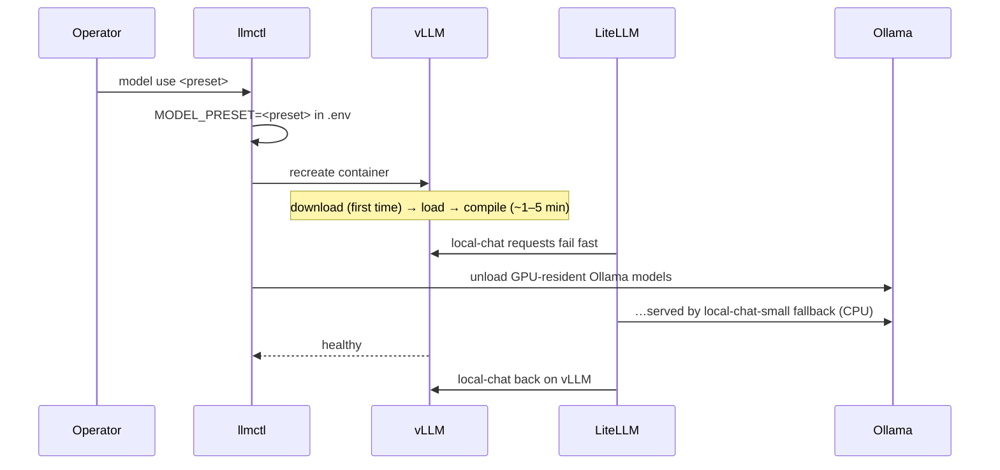

# Operations runbook

Everything goes through `./llmctl` (Windows: `bash llmctl`). Run `./llmctl help` for the list.

## Daily

| Task | Command |
|------|---------|
| Status | `./llmctl ps` |
| Logs | `./llmctl logs [vllm\|litellm\|cloudflared…]` |
| Health check | `./llmctl test` / `./llmctl test public <key>` |
| Dashboards | Grafana → *LLM Server* folder (via `./llmctl admin expose`, or `http://127.0.0.1:3000` locally): *LLM Engine (vLLM)*, *LLM Gateway (LiteLLM)* (filter by API key), *GPU* |

## Switching models

```bash
./llmctl model list                       # * marks the active preset
./llmctl model use qwen2.5-7b-instruct-awq
```

What happens:



Clients keep calling `local-chat`; nothing changes for them except the answers.

### Adding a model preset

Create `models/<name>.yaml`. Every key is a `vllm serve` flag without the `--`:

```yaml
# One-line description, VRAM need, and whether it's verified on real hardware.
model: org/model-repo-on-huggingface      # required
max-model-len: 16384
max-num-seqs: 16
enable-prefix-caching: true
enable-auto-tool-choice: true
tool-call-parser: hermes                  # match the model family
# reasoning-parser: qwen3                 # for reasoning models
```

Sizing rule of thumb on 16 GB at `gpu-memory-utilization=0.70` (~11 GB for vLLM):
weights + ~1 GB activations/graphs + KV cache. A 4-bit 8B model (~6 GB) leaves ~4 GB
KV ≈ 30k tokens for Qwen3-8B. If vLLM fails with *"No available memory for the cache
blocks"* lower `max-model-len` or raise the utilisation.

Gated models (Llama, Gemma) need `HF_TOKEN` in `.env` and the licence accepted on Hugging Face.

### Using Ollama models

Anything pulled into Ollama is instantly available as `ollama/<name>` — no restart:

```bash
ollama pull gemma3:12b
curl https://llm.example.com/v1/chat/completions -H "Authorization: Bearer $KEY" \
  -d '{"model":"ollama/gemma3:12b","messages":[{"role":"user","content":"hi"}]}'
```

Keys created with `--models local-chat,...` can't reach `ollama/*` unless you list them.
Ollama and vLLM share the GPU: big Ollama models will spill to CPU (slow) while vLLM
holds its reservation. `llmctl up` and `llmctl model use` evict Ollama's GPU-resident
models before vLLM starts, because vLLM sizes its KV cache from the VRAM that is free at
startup.

## API keys

```bash
./llmctl key create <alias> [--models a,b] [--rpm N] [--tpm N] [--parallel N] [--budget USD] [--duration 30d]
./llmctl key list
./llmctl key revoke <alias>
```

- Defaults (no flags): 60 RPM, 100k TPM, 4 parallel. Hard ceilings: 600 RPM, 500k TPM, 16 parallel (`config/litellm/config.yaml`).
- `--budget` is in USD of LiteLLM's cost map; local models cost $0 so use RPM/TPM to cap usage.
- Fine-grained management (teams, users, per-model limits, spend views) is in the LiteLLM admin UI.

## Configuration changes

| Changed | Apply with |
|---------|-----------|
| `.env` | `./llmctl up` (recreates changed services) |
| `config/litellm/config.yaml` | `./llmctl restart litellm` |
| `config/cloudflared/config.yml.tmpl`, hostnames | `./llmctl tunnel setup && ./llmctl restart cloudflared` |
| Prometheus / Grafana files | `./llmctl restart prometheus grafana` (Grafana does not notice file changes on its own) |
| Dashboards | Edit `scripts/gen_dashboards.py`, run `python3 scripts/gen_dashboards.py config/grafana/dashboards`, then `./llmctl restart grafana` |
| `config/api-docs/openapi.yaml` | `./llmctl restart api-docs` |
| Profiles `docs` / `webui` toggled | `./llmctl tunnel setup && ./llmctl up && ./llmctl restart cloudflared` (re-renders ingress) |

## Upgrades

All images are pinned in `.env` (`*_IMAGE_TAG`). To upgrade:

1. `./llmctl backup`
2. Bump one tag in `.env` (and its default in `.env.example` + `compose.yaml` for the repo).
3. `./llmctl up && ./llmctl test`
4. Roll back = restore the old tag and `./llmctl up`.

Upgrade one component at a time. vLLM releases occasionally rename flags — check the
release notes and `docker compose logs vllm` for `unrecognized arguments`.

## Backup and restore

The only stateful thing worth backing up is Postgres (keys, users, spend).
Models re-download; metrics are disposable.

```bash
./llmctl backup                          # → backups/litellm-YYYYmmdd-HHMMSS.sql.gz
./llmctl restore backups/<file>.sql.gz
```

Also keep `.env` and `config/cloudflared/*.json` somewhere safe (password manager) — they
are the machine's identity. Losing the tunnel credentials just means re-running
`tunnel setup` with a new `TUNNEL_NAME`.

## Troubleshooting

| Symptom | Likely cause | Fix |
|---------|-------------|-----|
| `local-chat` slow, header `x-litellm-attempted-fallbacks: 1` | vLLM down → served by Ollama | `./llmctl logs vllm` |
| vLLM: `Available KV cache memory: -x GiB` / `No available memory for the cache blocks` | VRAM held by other apps or Ollama when vLLM started | Close games, `ollama stop <model>` (llmctl does this for you on `up`/`model use`), or lower `VLLM_GPU_MEMORY_UTILIZATION` |
| vLLM restarting, `unrecognized arguments` | Preset key not valid for this vLLM version | Fix the preset |
| Public URL → **404** | Path not on the allowlist (only `/v1/*`, `/health/liveliness`, `/docs`) | Use `/v1/...` |
| Public URL → **502** | cloudflared up but LiteLLM down | `./llmctl ps`, `./llmctl logs litellm` |
| Public URL → **530 / 1033** | Tunnel not connected | `./llmctl logs cloudflared`, `./llmctl tunnel status` |
| Public URL → **524** after ~100 s | Cloudflare's proxy timeout on non-streamed long generations | Use `"stream": true` |
| **403** with Cloudflare HTML | Bot Fight Mode / browser check blocking the client | Set a real `User-Agent`, or add a WAF skip rule for `/v1/*` |
| **429** from gateway | Key hit its RPM/TPM/parallel limit | Raise it in the admin UI or issue a bigger key |
| `ollama/*` models missing in `/v1/models` | Ollama not reachable from container | Windows: Ollama app running? Linux: use the `ollama` profile |
