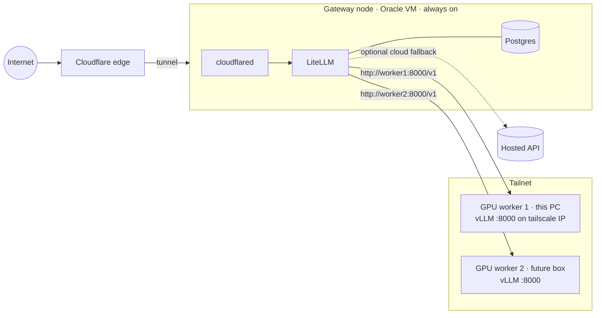

# Scaling and reuse

This repo is a blueprint: clone it onto any machine, `./llmctl init`, adjust `.env`,
`./llmctl up`. The same files cover the shapes below by changing `COMPOSE_PROFILES`
and two URLs.

## Topology A — single node *(default)*

Everything on one GPU box. What this repo runs today on the RTX 5060 Ti.

```ini
COMPOSE_PROFILES=vllm,tunnel,monitoring
```

## Topology B — always-on gateway + GPU workers over Tailscale

Put the gateway on a small always-on machine (e.g. the Oracle free VM) and run
inference on one or more GPU boxes that may come and go. The gateway keeps answering
(fallback/cloud model) even when the gaming PC is off.



**On each GPU worker** (clone repo, `./llmctl init`):

```ini
COMPOSE_PROFILES=vllm
VLLM_BIND_ADDR=100.x.y.z        # this machine's `tailscale ip -4`
VLLM_API_KEY=<same value as the gateway's VLLM_API_KEY>
```

Only vLLM starts (plus the always-on LiteLLM/Postgres, which you can ignore or
`docker compose stop`). vLLM's port is published on the Tailscale interface only.

**On the gateway** (clone repo, `./llmctl init`):

```ini
COMPOSE_PROFILES=tunnel,monitoring
VLLM_API_BASE=http://<worker1-tailscale-name>:8000/v1
```

For several workers serving the same alias, add more `local-chat` entries in
`config/litellm/config.yaml` with different `api_base`s — LiteLLM load-balances
entries that share a `model_name`:

```yaml
  - model_name: local-chat
    litellm_params: {model: hosted_vllm/primary, api_base: http://worker1:8000/v1, api_key: os.environ/VLLM_API_KEY}
  - model_name: local-chat
    litellm_params: {model: hosted_vllm/primary, api_base: http://worker2:8000/v1, api_key: os.environ/VLLM_API_KEY}
```

Prometheus on the gateway can scrape workers by adding their `host:8000` targets.

> Free-tier ARM VMs are fine for LiteLLM/Postgres/cloudflared — they never touch a GPU.
> Docker on the gateway needs no NVIDIA runtime because the `vllm` profile is off.

## Cloud fallback

When the GPU box is down, route `local-chat` to a hosted model instead of (or after)
Ollama. Add a deployment and extend `fallbacks` in `config/litellm/config.yaml`:

```yaml
  - model_name: cloud-fallback
    litellm_params:
      model: openrouter/qwen/qwen3-8b       # any LiteLLM-supported provider
      api_key: os.environ/OPENROUTER_API_KEY

router_settings:
  fallbacks:
    - local-chat: ["local-chat-small", "cloud-fallback"]
```

Add `OPENROUTER_API_KEY` to `.env` and to the `litellm` service's `environment`.
Now `--budget` on keys becomes meaningful since cloud calls have a real cost.

## Bigger hardware

| Hardware | Change |
|----------|--------|
| 24 GB GPU | `qwen3-14b-awq` preset, `VLLM_GPU_MEMORY_UTILIZATION=0.90`, raise `max-model-len` |
| 2+ GPUs in one box | Add `tensor-parallel-size: 2` to a preset, serve 32B–70B AWQ models |
| Several GPU boxes | Topology B, one vLLM per box, LiteLLM load-balances |
| Many nodes needing scheduling/autoscaling | Graduate to Kubernetes (vLLM production-stack / KServe). Same LiteLLM config ports over. |

## Reuse checklist for a new machine

1. Install prerequisites ([setup.md §1](setup.md#1-prerequisites)).
2. `git clone` → `./llmctl init` → `./llmctl doctor`.
3. Pick `MODEL_PRESET` for the VRAM; set a **unique** `TUNNEL_NAME` and hostname.
4. `./llmctl up` → `./llmctl test`.
5. `./llmctl tunnel setup` → `./llmctl up` → `./llmctl key create …` → `./llmctl test public <key>`.
6. `./llmctl admin expose`.
