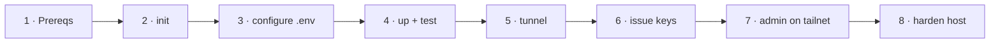

# Setup — fresh machine to public API

Target: ~30 minutes, most of it the first image + model download.



## 1. Prerequisites

| | Windows 11 | Linux (Ubuntu 22.04+) |
|-|-----------|------------------------|
| GPU driver | NVIDIA Game/Studio driver (WSL support is built in) | `nvidia-driver-5xx` or newer |
| Docker | Docker Desktop, WSL 2 backend | Docker Engine + Compose v2 + [NVIDIA Container Toolkit](https://docs.nvidia.com/datacenter/cloud-native/container-toolkit/latest/install-guide.html) |
| Shell | Git Bash (ships with Git for Windows) | bash |
| Optional | Ollama (native), Tailscale | Tailscale |

Hardware guide (single model at a time):

| VRAM | Preset | Notes |
|------|--------|-------|
| 8 GB | `qwen3-4b-awq` | set `VLLM_GPU_MEMORY_UTILIZATION=0.80` |
| 12–16 GB | `qwen3-8b-awq` *(default)* | 0.70 leaves ~4 GB for desktop + Ollama |
| 16 GB dedicated / 24 GB | `qwen3-14b-awq` | 0.90 on a headless box |
| 24 GB+ | any ≤ 32B AWQ model | write a new preset |

Disk: vLLM image ~33 GB, each 8B AWQ model ~6 GB.

Check everything:

```bash
./llmctl doctor
```

## 2. Clone and initialise

```bash
git clone https://github.com/givewgun/local-llm-server.git
cd local-llm-server
./llmctl init        # creates .env, generates every secret
```

On Windows use PowerShell with `.\llmctl.ps1 …` (it finds Git Bash for you), or Git Bash with `bash llmctl …`. Plain `bash` in PowerShell is WSL's launcher and won't work.

## 3. Configure `.env`

The handful of values you actually edit:

```ini
COMPOSE_PROFILES=vllm,monitoring          # `tunnel setup` adds ,tunnel; add ,docs for public Swagger at /docs, ,webui for a chat UI, ,ollama on Linux
MODEL_PRESET=qwen3-8b-awq
VLLM_GPU_MEMORY_UTILIZATION=0.70
API_HOSTNAME=llm.yourdomain.com
CHAT_HOSTNAME=chat.yourdomain.com
TUNNEL_NAME=llm-<machine-name>            # unique per machine
OLLAMA_API_BASE=http://host.docker.internal:11434   # http://ollama:11434 with the ollama profile
```

The fallback alias `local-chat-small` uses `llama3.2:3b-cpu`, a CPU-only copy of
Llama 3.2 3B (`num_gpu 0`, ~20 tok/s on a desktop CPU). `./llmctl up` pulls and creates it
automatically. It runs on CPU on purpose: a fallback that loads into VRAM while vLLM is
starting would shrink vLLM's KV cache or stop it from starting at all.

## 4. First start (local only)

Start without the tunnel first so problems stay local:

```bash
./llmctl up
./llmctl test
```

Expected:

```text
smoke test -> http://localhost:4000  model=local-chat
  [PASS] liveness  HTTP 200
  [PASS] rejects bad key  HTTP 401
  [PASS] lists models  local-chat, local-chat-small, ollama/...
  [PASS] chat completion  0.47s  -> 'pong'
  [PASS] streaming  33 chunks in 0.47s
  [PASS] admin routes need master key  HTTP 401
OK
```

First boot downloads the model (~6 GB) and compiles CUDA graphs: 3–6 minutes.
Follow along with `./llmctl logs vllm`.

## 5. Public ingress (Cloudflare Tunnel)

Requires the domain to be on Cloudflare DNS.

```bash
./llmctl tunnel setup
```

This will:

1. Print a Cloudflare login URL → open it, pick your zone, **Authorize**. A zone-scoped `cert.pem` lands in `config/cloudflared/` (git-ignored).
2. Create the tunnel `$TUNNEL_NAME` and its credentials file.
3. Render `config/cloudflared/config.yml` from the template (API path allowlist).
4. Create the proxied CNAME `$API_HOSTNAME → <tunnel-id>.cfargotunnel.com` (and `$CHAT_HOSTNAME` if `webui` is on).

Then:

```bash
./llmctl up
```

## 6. Issue keys

Never hand out the master key. One virtual key per consumer:

```bash
./llmctl key create panya --models local-chat,local-chat-small --rpm 60 --tpm 100000 --parallel 4
./llmctl test public sk-<the-new-key>
```

## 7. Admin plane on the tailnet

```bash
./llmctl admin expose
```

First time only: if it prints *"Serve is not enabled on your tailnet"* with a
`login.tailscale.com/f/serve?...` link, open it, enable HTTPS/Serve for the tailnet, and
the command continues by itself.

Now from any device on your tailnet:

- LiteLLM admin UI: `https://<machine>.<tailnet>.ts.net/ui` — log in with `LITELLM_UI_USERNAME` / `LITELLM_UI_PASSWORD`
- Grafana: `https://<machine>.<tailnet>.ts.net:8443` — `admin` / `GRAFANA_ADMIN_PASSWORD`

## 8. Harden the host

These are machine settings the repo deliberately does not change for you:

- **Never sleep.** Windows: *Settings → System → Power → Screen and sleep → When plugged in, put my device to sleep after: Never*. Linux: `sudo systemctl mask sleep.target suspend.target hibernate.target hybrid-sleep.target`.
- **Start on boot.** Windows: Docker Desktop → *Settings → General → Start Docker Desktop when you sign in*, and enable auto sign-in or run Docker as a service. Linux: `sudo systemctl enable docker`. All services use `restart: unless-stopped`, so they come back with the daemon.
- **Windows Update active hours** set so reboots don't land mid-demo.
- **Cloudflare dashboard** (optional, recommended): WAF → Rate limiting rule on `llm.<domain>` (e.g. 120 req/min per IP) as a second layer in front of LiteLLM's per-key limits.
